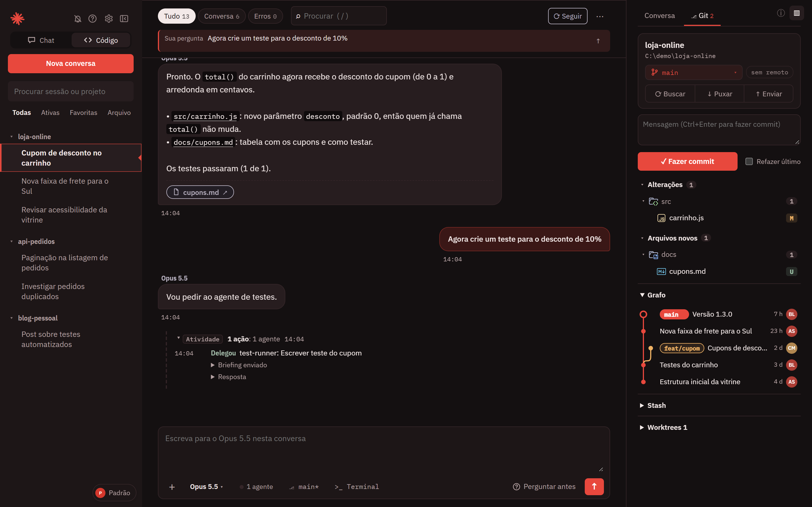
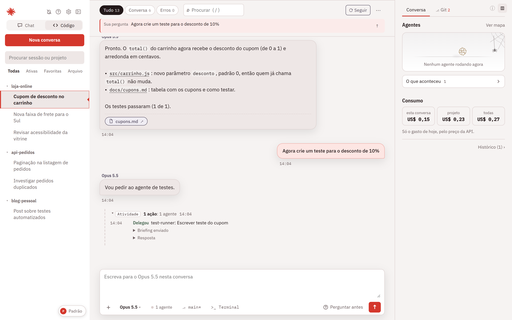
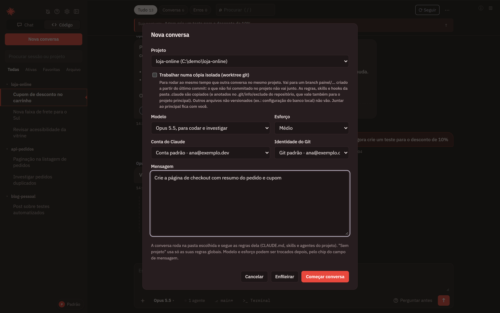
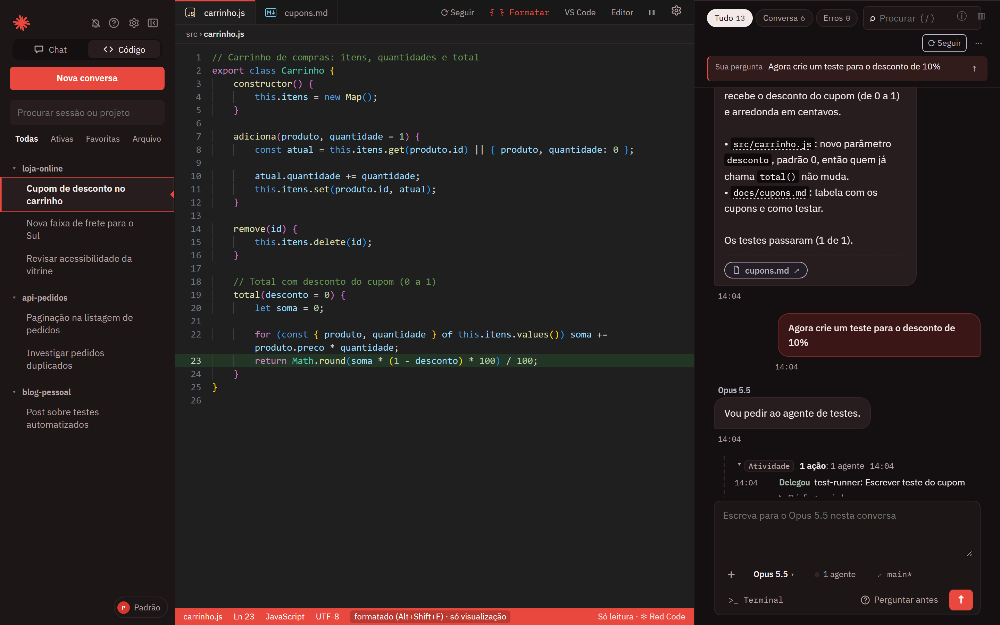
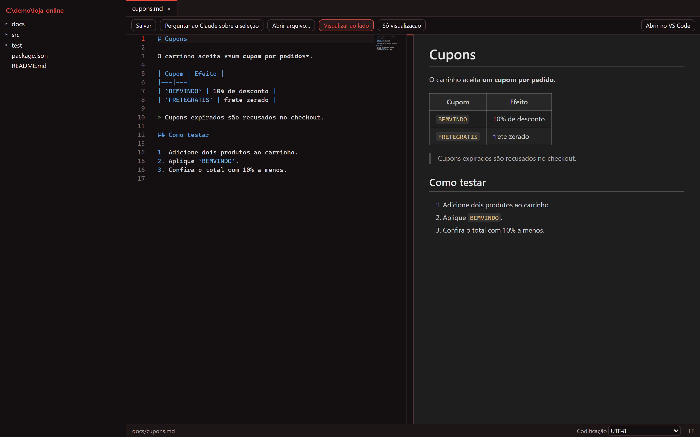
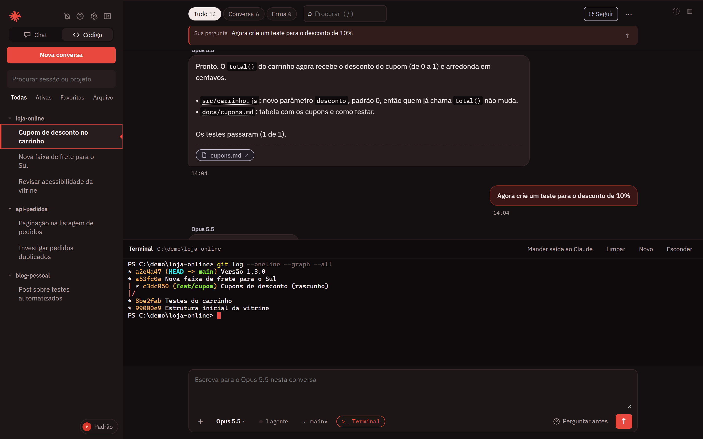
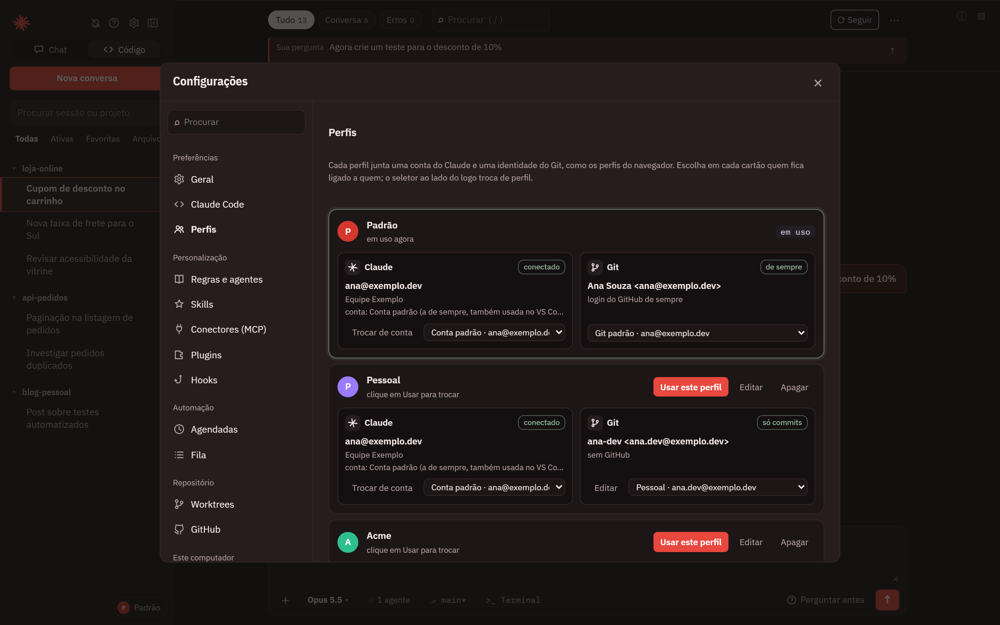

<p align="center">
  
</p>

<h1 align="center">Red Code</h1>

<p align="center">
  App desktop para Windows que acompanha e conversa com o Claude Code, numa janela só, usando a conta do Claude Code que já está logada no seu PC.
</p>

<p align="center">
  
  
  
  
</p>

<p align="center">
  <a href="#funcionalidades">Funcionalidades</a> ·
  <a href="#instalação">Instalação</a> ·
  <a href="#atalhos">Atalhos</a> ·
  <a href="#perfis">Perfis</a>
</p>

<p align="center">
  
</p>

## Destaques

- Usa a conta do Claude Code que já está logada no PC. Não pede chave de API.
- Acompanha o Claude ao vivo: linha do tempo, agentes em segundo plano e pedidos de permissão na própria página.
- O editor mostra o arquivo que o Claude está alterando, no momento em que muda.
- Painel Git com grafo de branches, commit, fetch, pull, push e worktrees.
- Perfis com várias contas do Claude e várias identidades do Git. Cada conversa pode usar a sua.
- Terminal, editor e navegador embutidos, na pasta do projeto.

## Funcionalidades

### Conversas e acompanhamento

- Lista as conversas do Claude Code, agrupadas por projeto, com o estado de cada uma.
- Linha do tempo ao vivo com filtros (comandos, edições, leituras, agentes, erros) e um mapa dos agentes em segundo plano.
- Painel lateral com o palco de agentes e o consumo do dia, pelo preço da API: esta conversa, o projeto ou todas.
- Mostra os limites de uso do plano e o consumo da conversa.
- Avisa no Windows quando uma conversa termina ou faz uma pergunta.



### Conversar pelo app

- Dois modos, no alternador do topo da barra lateral:
  - **Código** (`</>`): conversa dentro de uma pasta de projeto, com arquivos, terminal e todas as ferramentas do Claude Code.
  - **Chat** (balão): conversa comum, sem pasta e sem ferramentas. Não lê arquivos, não roda comandos e não acessa a internet.
- Permissões e perguntas de múltipla escolha são respondidas na própria página.
- Modo de permissão, modelo e esforço escolhidos por conversa. Anexos de imagens e arquivos. `/` para comandos e skills, `@` para citar arquivos do projeto.
- Checkpoint: volta os arquivos ao estado de uma mensagem anterior.
- Continua uma conversa grande numa conversa nova, com um resumo, mantendo as duas ligadas.
- Painel **Tarefas em segundo plano** acima do campo de mensagem, com botão para parar cada tarefa.
- Menu **⋯** da conversa com ações seguras. Arquivar fica longe de um clique acidental. **Dados da conversa** mostra os dados e permite começar uma conversa nova a partir deles.
- Desativar um agente do projeto vale só para você.



Na janela de **Nova conversa** você escolhe o projeto, a cópia isolada (worktree), o modelo, o esforço, a conta do Claude e a identidade do Git da conversa. **Enfileirar** guarda o pedido para depois.

### Editor ao vivo

- Mostra o arquivo real que o Claude está alterando, no momento em que muda, com animação de escrita.
- Também acompanha o que comandos PowerShell e Bash gravam.
- Aparece só quando o Claude mexe em código. Tem abas por arquivo.
- Botão **Formatar**: mostra o arquivo formatado como o Alt + Shift + F do VS Code deixaria (só visualização, o arquivo não muda). **Abrir no VS Code** leva o arquivo para o editor.



### Editor de arquivos e Markdown

- Editor Monaco que preserva a codificação, o BOM e o fim de linha do arquivo.
- Visualização de Markdown igual à do VS Code: ao lado do código com `Ctrl` + `K`, depois `V`, ou sozinha com `Ctrl` + `Shift` + `V`.
- A visualização atualiza enquanto você digita.



### Terminal

- Terminal PowerShell embutido, aberto na pasta do projeto.
- Botão **Mandar saída ao Claude** para levar a saída do terminal à conversa.



### Painel Git

- Estado, diff, grafo, branches, stash, commit, fetch, pull, push e worktrees.
- Alterações agrupadas por pasta. O grafo mostra as branches com o avatar ou as iniciais de cada autor.
- Segue o repositório que a conversa está editando.
- Usa a identidade Git da conversa, quando ela tem uma. Veja [Perfis](#perfis).


### Perfis

- Cada perfil junta uma conta do Claude e uma identidade do Git. O seletor no rodapé da lista de conversas troca o Red Code inteiro.
- Cada conversa pode ter a sua própria conta do Claude e a sua própria identidade do Git.
- Painel Git, terminal, commits e push feitos pelo Claude numa conversa usam a identidade dela. As outras conversas seguem o perfil.
- A lista mostra um selo quando a conversa usa conta ou identidade diferente do perfil.



### Outras ferramentas

- Ponte com o VS Code aberto: o Claude enxerga os erros do editor, a seleção e as abas.
- Navegador embutido que o Claude controla: abrir páginas, ler, clicar, digitar e tirar print.
- Integrações: GitHub pelo `gh` (só leitura: PRs e CI), lista dos hooks configurados e card do Trello ligado a cada conversa.
- Conversas em paralelo no mesmo projeto, cada uma numa cópia isolada (worktree, branch `painel/...`).
- Tarefas agendadas e fila de pedidos. Nada é aprovado sozinho: pedidos de permissão sempre esperam você.
- Busca em todas as conversas, resumo do dia, linha do tempo de um arquivo e modelos de pedido.

## Requisitos

- **Windows.** O terminal e o empacotamento são para Windows.
- **Claude Code instalado e com login feito** na sua conta. O app usa essa conta.
- **Git**, para o painel Git e os worktrees.
- Opcionais: **VS Code** (ponte com o editor) e **GitHub CLI (`gh`)** (aba de PRs e CI).
- **Node 24 ou superior**, só para rodar pelo código ou gerar o exe. O exe portátil não precisa de Node.

## Instalação

### Baixar o exe pronto (recomendado)

1. Na página de [Releases](https://github.com/HickysDev/redCode/releases/latest), baixe o `RedCode-portatil-win64.zip`.
2. Extraia a pasta **Red Code** onde quiser (ex.: Documentos).
3. Abra o **Red Code.exe**. Não precisa instalar nem ter Node.

Os dados e logs ficam em `%APPDATA%\Red Code`, então dá para trocar a pasta por uma versão nova sem perder nada.

### Rodar pelo código

```bash
git clone https://github.com/HickysDev/redCode.git
cd redCode
npm install
npm run desktop
```

Na primeira vez, o Electron é baixado durante o `npm install` ou na primeira abertura, então pode demorar.

Para abrir de novo depois, use `npm run desktop` ou o arquivo `abrir-painel-desktop.cmd`. Você pode criar um atalho na área de trabalho apontando para `node_modules\electron\dist\electron.exe` com o argumento `desktop\main.js`.

### Só no navegador

```bash
npm install
npm start
```

Abre o servidor local, e a página fica em `http://127.0.0.1:4317`. Esse modo não tem bandeja, atalho global, seletor de pastas do Windows nem navegador embutido.

Não abra o `index.html` direto da pasta: a página precisa do servidor e fica em branco sem ele.

### Gerar o exe portátil

```bash
npm install
npm run empacotar
```

Gera `dist\Red Code\Red Code.exe` e `dist\RedCode-portatil-win64.zip`. Não baixa nada além das dependências do `npm install`. O exe traz o próprio Node, então quem for usar não precisa instalar Node. A pasta `Red Code` pode ficar em qualquer lugar (por exemplo, `Documentos`), menos em `Arquivos de Programas`.

## Primeiros passos

1. Abra o app. A lista da esquerda mostra as conversas que você já tem no Claude Code.
2. Clique em **Nova conversa**.
   - No modo **Código**, escolha o projeto na lista, **Outra pasta…** (abre o seletor de pastas do Windows) ou **Sem pasta específica**. Marque a cópia isolada (worktree) se for rodar ao mesmo tempo que outra conversa no mesmo projeto.
   - No modo **Chat**, só escolha modelo, esforço e escreva a mensagem.
3. Escolha o modelo e o esforço, escreva o pedido e clique em **Começar conversa**.
4. Acompanhe na linha do tempo. Se o Claude pedir permissão ou fizer uma pergunta, o cartão aparece acima do campo de mensagem.

O botão **ⓘ** (canto superior direito) mostra os detalhes da conversa: modelo, saúde do contexto e números. O botão **▥** abre o painel lateral com agentes e Git. Os dois lembram a sua escolha.

## Atalhos

| Atalho | O que faz |
|---|---|
| `Ctrl` + `Shift` + `Espaço` | Mostrar ou esconder a janela (global, funciona de qualquer lugar) |
| `Ctrl` + `Shift` + `F` | Buscar em todas as conversas |
| `Ctrl` + acento grave | Abrir ou fechar o terminal |
| `/` | Procurar nesta sessão |
| `1` a `7` | Trocar o filtro da linha do tempo |
| `e` / `r` | Expandir / recolher todos os blocos de ações |
| `f` | Ligar ou desligar o acompanhamento do fim |
| `j` / `k` | Próxima / anterior conversa da lista |
| `n` | Continuar a conversa atual numa conversa nova |
| `c` | Escrever na caixa de mensagem |
| `m` | Abrir ou fechar o mapa de agentes |
| `Esc` | Interromper a resposta em andamento |
| `/` ou `@` na caixa | Comandos e skills / citar arquivo do projeto |
| `F5` ou `Ctrl` + `R` | Recarregar a página |
| `Ctrl` + `K`, depois `V` | Mostrar a visualização de Markdown ao lado do código (editor) |
| `Ctrl` + `Shift` + `V` | Abrir a visualização de Markdown sozinha (editor) |

Fechar a janela só a esconde na bandeja do sistema. Para encerrar o app de verdade, use **Sair** no ícone da bandeja.

## Perfis

Funcionam como os perfis do navegador. O seletor de perfil, no rodapé da lista de conversas, troca o Red Code inteiro. Monte os perfis em **Configurações › Perfis**.

- **Conta do Claude:** cada conta tem a própria pasta, com login, configurações e conversas. Ela é usada pelo Claude Code por meio de `CLAUDE_CONFIG_DIR`.
  - Ao criar, dá para copiar suas configurações da conta padrão: CLAUDE.md, hooks, agentes, skills, plugins e MCP.
  - Login e conversas nunca são copiados.
  - **Entrar** abre o `/login` do Claude num terminal.
- **Identidade do Git:** nome e e-mail dos commits, mais o usuário do GitHub.
  - O login do GitHub é feito pelo Git Credential Manager, guardado num espaço só da identidade (`credential.namespace`). O login de sempre não muda.
  - Antes do primeiro login, **Verificar segurança** confirma isso: grava e apaga uma credencial falsa num endereço inventado.
- **Perfil:** junta uma conta e uma identidade, por exemplo "Pessoal" ou "Claude pessoal + Git da empresa".
  - O perfil **Padrão** é o Red Code de sempre, sem nenhuma variável. "Conta padrão" e "Git padrão" são os da máquina.
  - A lista de conversas mostra só as da conta do perfil em uso.
  - Agendamentos e fila só rodam no perfil em que foram criados.
- **Trocar de perfil** reinicia o servidor do Red Code assim que nenhuma conversa ou terminal estiver rodando. Dá para cancelar ou usar **Trocar agora**, que para tudo antes.
- **Dados dos perfis** ficam em `%APPDATA%\Red Code\perfis`. A variável `PAINEL_PERFIS` troca esse caminho. Nenhum token fica nesse arquivo.
- **Dentro de um perfil**, o `git config --global` grava num arquivo do Red Code que é refeito a cada subida.

## Onde ficam os dados

- **App desktop:** favoritos, vínculos entre conversas, anexos e logs ficam em `%APPDATA%\Red Code`. Trocar a pasta do app por uma versão nova não apaga esses dados.
- **Só servidor (`npm start`):** o `dados.json` e a pasta de anexos ficam ao lado do `server.js`.
- **Conversas:** lidas de `~/.claude/projects`. O app não copia nem envia esse conteúdo.
- **Conversas do modo Chat:** gravadas pelo Claude Code em `~/.claude/projects`, na pasta que corresponde a `%APPDATA%\Red Code\chat`.

## Segurança

- O servidor escuta apenas em `127.0.0.1:4317`, nunca na rede.
- O terminal só aceita conexão da própria página, com um token secreto gerado a cada abertura.
- O navegador embutido roda numa janela isolada, sem acesso ao token do painel.
- Segredos que o app desktop passa ao servidor são lidos uma vez e apagados do ambiente, para não vazarem para os processos que o servidor inicia.
- O editor e as operações de arquivo ficam presos dentro da pasta do projeto.
- No modo Chat, o Claude roda sem ferramentas, sem servidores MCP e sem carregar o seu `CLAUDE.md`.

## Problemas comuns

- **SmartScreen avisa na primeira execução do exe.** O exe não é assinado. Clique em **Mais informações** e depois em **Executar assim mesmo**.
- **O exe mostra o ícone do Electron no Explorer.** A janela e a barra de tarefas mostram o ícone vermelho do Red Code.
- **Alterei o código e nada mudou.** O servidor e o app desktop só carregam o código na abertura. Feche pela bandeja (**Sair**) e abra de novo. Para mudanças só na página, `F5` basta.
- **O atalho `Ctrl` + `Shift` + `Espaço` não funciona.** Outro programa está usando. O app avisa no log e segue funcionando sem ele.
- **A página abre em branco.** Confirme que o servidor está rodando e acesse `http://127.0.0.1:4317`, ou abra pelo app desktop.
- **A porta 4317 está ocupada.** Defina outra com a variável de ambiente `PAINEL_PORTA` antes de abrir.
- **A lista vem vazia.** O app só mostra o que o Claude Code já gravou em `~/.claude/projects`. Confirme que o Claude Code está instalado e que você já fez alguma conversa.

## Estrutura do projeto

| Arquivo | Função |
|---|---|
| `desktop/main.js`, `preload.js` | Casca Electron: janela, bandeja, atalho global, seletor de pastas |
| `desktop/navegador.js` | Navegador embutido controlado pelo Claude |
| `server.js` | Servidor local: lê as conversas e serve a página e a API |
| `chat.js` | Conversa com o Claude Code pelo SDK oficial, permissões e modo Chat |
| `index.html`, `editor.html`, `editor.js` | Interface da página e editor |
| `terminal.js` | Terminal PowerShell por WebSocket |
| `git-scm.js`, `worktrees.js` | Painel Git e worktrees |
| `editor-arquivos.js` | Árvore, leitura e gravação de arquivos para o editor |
| `integracoes.js` | GitHub (`gh`), hooks e Trello |
| `automacao.js` | Tarefas agendadas e fila de pedidos |
| `alem.js` | Busca global, resumo do dia, linha do tempo de arquivo |
| `vscode-ponte.js` | Ponte com o VS Code aberto |
| `segredos.js` | Leitura única dos segredos do app desktop |
| `lancador.js` | Sobe o servidor e o reinicia quando ele pede |
| `empacotar.js` | Gera o exe portátil |
| `ferramentas/medir.js` | Mede elementos e tira prints da página para depuração |

## Desenvolvimento

```bash
npm install
npm run desktop     # app completo
npm start           # só o servidor, em http://127.0.0.1:4317
npm run empacotar   # exe portátil em dist\
```

Não há testes automatizados no projeto.

## Licença

O `package.json` declara a licença ISC, mas o repositório ainda não tem um arquivo `LICENSE`.
